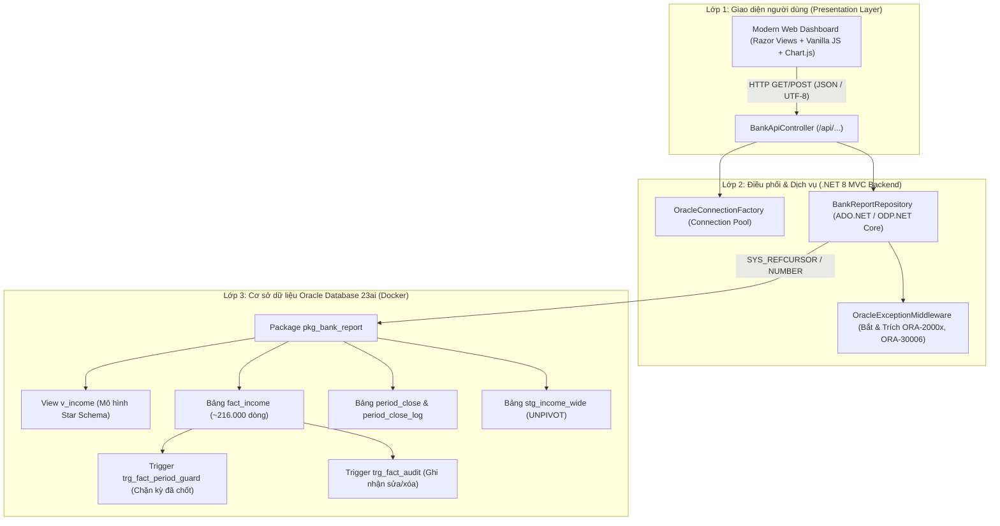

# Hệ Thống Báo Cáo Tài Chính Hợp Nhất Cho Ngân Hàng
> **Đề tài 5 — Các Hệ Quản Trị Cơ Sở Dữ Liệu (Oracle Database 23ai)**  
> **Khoa Công nghệ Thông tin — Bộ môn Hệ thống Thông tin — HUFLIT (2026)**  
> **Kiến trúc:** ASP.NET Core MVC (.NET 8, C#) + Oracle Database 23ai Free (Docker)

---

## 1. Giới thiệu tổng quan
Hệ thống giải quyết bài toán báo cáo tài chính hợp nhất nhiều chiều cho ngân hàng thương mại đa chi nhánh:
- **Trọng tâm công nghệ Oracle 23ai:** Mệnh đề nhóm nâng cao `ROLLUP`, `CUBE`, `GROUPING SETS`, phân biệt dòng tổng bằng `GROUPING` & `GROUPING_ID`, xoay trục dữ liệu `PIVOT`, `PIVOT động (Dynamic SQL)` và `UNPIVOT` để nạp dữ liệu từ bảng rộng dạng Excel.
- **Toàn vẹn & An toàn giao dịch:** Cơ chế chốt quý (`period_close`) kết hợp Trigger chặn (`trg_fact_period_guard`) và khóa bảo vệ `LOCK TABLE ... IN SHARE MODE WAIT 10` chống tranh chấp đồng thời, cùng Trigger kiểm toán (`trg_fact_audit`).
- **Giao diện người dùng:** Modern Executive Banking Dashboard tích hợp Chart.js, hỗ trợ chuyển đổi Light/Dark mode, định dạng số chuẩn Việt Nam, hỗ trợ xuất CSV/Excel UTF-8 BOM, hiển thị mã lỗi nguyên văn từ Oracle Database.

---

## 2. Sơ đồ kiến trúc 3 lớp



---

## 3. Bảng mã lỗi nghiệp vụ Oracle Database

Toàn bộ logic nghiệp vụ được đóng gói trực tiếp trong CSDL Oracle. Tầng .NET điều phối và middleware trích xuất dòng lỗi đầu tiên để trả về mã HTTP `400 Bad Request`:

| Mã lỗi | Tên lỗi nghiệp vụ | Mô tả & Tình huống kích hoạt |
|---|---|---|
| `ORA-20001` | Kỳ hoặc chế độ báo cáo không hợp lệ | Quý ngoài Q1..Q4, năm không khớp `dim_period`, hoặc `p_mode` ngoài ROLLUP/CUBE/SETS/PIVOT/PIVOT_DYN. |
| `ORA-20002` | Chi nhánh không tồn tại | Mã chi nhánh (`p_branch`) không tồn tại trong `dim_branch`. |
| `ORA-20003` | Kỳ đã chốt, không được thêm/sửa/xoá | Do Trigger `trg_fact_period_guard` kích hoạt khi thao tác trên quý có trong `period_close`. |
| `ORA-20004` | Quý đã được chốt trước đó | Bắt ngoại lệ `DUP_VAL_ON_INDEX` khi chốt một quý đã ở trạng thái CLOSED. |
| `ORA-20005` | Sản phẩm không tồn tại | Mã sản phẩm (`p_product`) không tìm thấy trong `dim_product`. |
| `ORA-20006` | Khoản mục không tồn tại | Mã khoản mục thu/chi (`p_item`) không có trong `dim_income_item`. |
| `ORA-20007` | Số tiền phải lớn hơn 0 | Số tiền giao dịch (`p_amount`) bị rỗng hoặc `<= 0`. |
| `ORA-20008` | Quý chưa được chốt | Mở lại quý chưa từng được chốt trong bảng `period_close`. |
| `ORA-30006` | Resource busy; acquire with WAIT timeout | Bị từ chối khi tài nguyên đang bị khóa bởi phiên khác quá thời gian chờ (10 giây). |

---

## 4. Hướng dẫn cài đặt & Chạy hệ thống

### Bước 1: Khởi động Oracle Database 23ai trên Docker
```bash
# Khởi động container từ docker-compose.yml
docker compose up -d

# Hoặc bằng lệnh docker run trực tiếp:
docker run -d --name oracle23ai -p 1521:1521 \
  -e ORACLE_PWD=Oracle123 \
  -v oracle_data:/opt/oracle/oradata \
  container-registry.oracle.com/database/free:latest

# Kiểm tra trạng thái container (đợi đến khi có chữ "healthy"):
docker ps
```

### Bước 2: Nạp kịch bản CSDL Oracle
Kết nối vào PDB `FREEPDB1` qua công cụ SQL Developer / DBeaver / sqlplus:
1. **Kết nối bằng user `system / Oracle123`**:
   Chạy file `sql/00_create_user.sql` để tạo user `bank` và cấp quyền `DB_DEVELOPER_ROLE`.
2. **Kết nối bằng user `bank / bank123`**:
   Chạy toàn bộ file `sql/all_in_one.sql` (Alt+X trong DBeaver hoặc F5 trong SQL Developer).  
   *Script tự động tạo 12 bảng, 1 view, nạp 216.000 dòng dữ liệu mẫu, tạo package `pkg_bank_report`, 2 trigger, thực hiện tối ưu hóa và chạy 13 kịch bản kiểm thử T1–T9b.*

### Bước 3: Chạy ứng dụng ASP.NET Core MVC (.NET 8)
```bash
# Di chuyển vào thư mục Web
cd src/BankConsolidatedReport.Web

# Khôi phục dependencies và build
dotnet restore
dotnet build --configuration Release

# Khởi chạy ứng dụng Web
dotnet run
```
Truy cập trình duyệt tại địa chỉ: **`http://localhost:5000`** (hoặc port thông báo trên terminal).

### Bước 4: Chạy Unit / Integration Tests
```bash
# Chạy 26 kịch bản kiểm thử tự động
dotnet test --configuration Release --verbosity normal
```

---

## 5. Cấu trúc thư mục dự án

```
NganHang/
├── BankConsolidatedReport.sln            # Solution .NET 8
├── docker-compose.yml                     # Cấu hình container Oracle 23ai Free
├── README.md                              # Hướng dẫn chi tiết & tài liệu kỹ thuật
├── .gitignore                             # Bộ lọc git chuẩn cho .NET & OS
├── sql/
│   ├── 00_create_user.sql                 # Tạo user bank & cấp quyền
│   ├── all_in_one.sql                     # Schema, dữ liệu mẫu, package, trigger, test T1-T9b
│   └── 04_concurrency_test.sql            # Kịch bản kiểm thử tranh chấp 2 phiên
├── src/
│   └── BankConsolidatedReport.Web/        # Dự án Web ASP.NET Core MVC (.NET 8)
│       ├── Controllers/
│       │   ├── HomeController.cs          # Điều hướng View
│       │   └── Api/BankApiController.cs   # REST API phục vụ Frontend
│       ├── Data/
│       │   └── OracleConnectionFactory.cs # Quản lý kết nối ADO.NET & Retry
│       ├── Repositories/
│       │   └── BankReportRepository.cs    # Gọi trực tiếp pkg_bank_report ODP.NET
│       ├── Middleware/
│       │   └── OracleExceptionMiddleware.cs # Bắt & chuẩn hóa mã lỗi ORA-2000x
│       ├── Views/
│       │   ├── Home/Index.cshtml          # Giao diện Modern Banking Dashboard
│       │   └── Shared/_Layout.cshtml      # Layout, Sidebar, TopHeader, Theme
│       └── wwwroot/
│           ├── css/site.css               # Biến màu, Dark/Light Mode, Table, Responsive
│           └── js/site.js                 # Điều phối API, Chart.js, Toast, Export
└── tests/
    └── BankConsolidatedReport.Tests/      # Kiểm thử xUnit (26 tests, 100% PASS)
        └── BankReportTests.cs             # Test xử lý ORA-*, format số, GID, Models
```

---

## 6. Đối chiếu yêu cầu kỹ thuật & Kịch bản bảo vệ

| Hạng mục | Yêu cầu đề bài | Kết quả hiện thực |
|---|---|---|
| **CSDL** | Oracle Database 23ai Free | Container Docker `oracle23ai`, service `FREEPDB1`. |
| **Bảng dữ liệu** | $\ge 5$ bảng quan hệ | 12 bảng (10 nghiệp vụ + 2 hỗ trợ) + 1 view `v_income`. |
| **Dữ liệu mẫu** | Đủ quy mô thử nghiệm | Đúng 216.000 dòng `fact_income` mô phỏng 9 chi nhánh $\times$ 8 sản phẩm $\times$ 5 khoản mục $\times$ 24 tháng $\times$ 25 lần. |
| **Mã nguồn PL/SQL** | $\ge 1$ package, $\ge 2$ trigger, $\ge 3$ proc/func | Package `pkg_bank_report` (6 hàm/thủ tục), Trigger `trg_fact_period_guard`, Trigger `trg_fact_audit`. |
| **Công nghệ OLAP** | ROLLUP, CUBE, SETS, PIVOT, UNPIVOT | Cả 5 chế độ tích hợp mượt mà, phân biệt dòng tổng bằng `GROUPING_ID`, PIVOT động sinh cột theo danh mục. |
| **Ứng dụng Web** | ASP.NET Core MVC (.NET 8, C#) | Kiến trúc 3 lớp, gọi trực tiếp ADO.NET qua `Oracle.ManagedDataAccess.Core`. |
| **Kiểm thử tự động** | $\ge 5$ kịch bản | 13 test Oracle CSDL (T1–T9b) + 26 test xUnit C# + Smoke Test E2E 100% PASS. |
